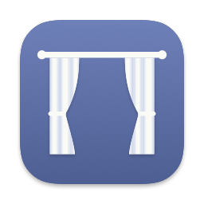
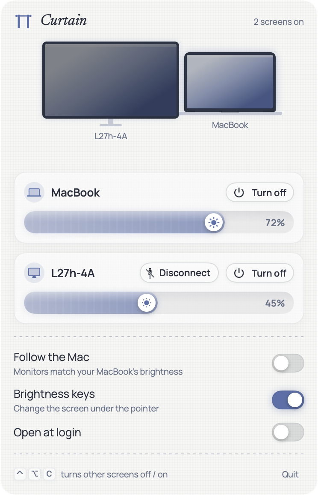
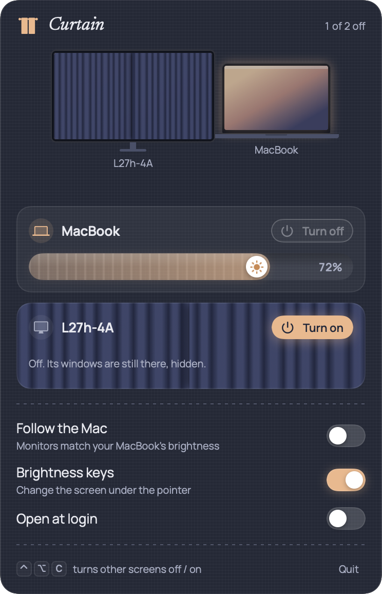
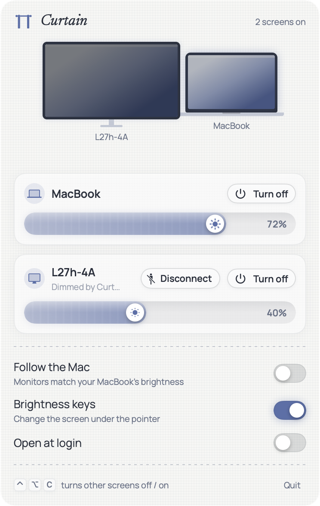
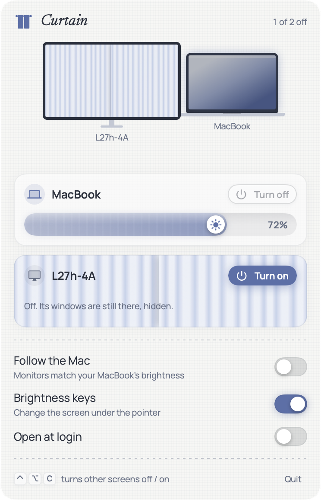
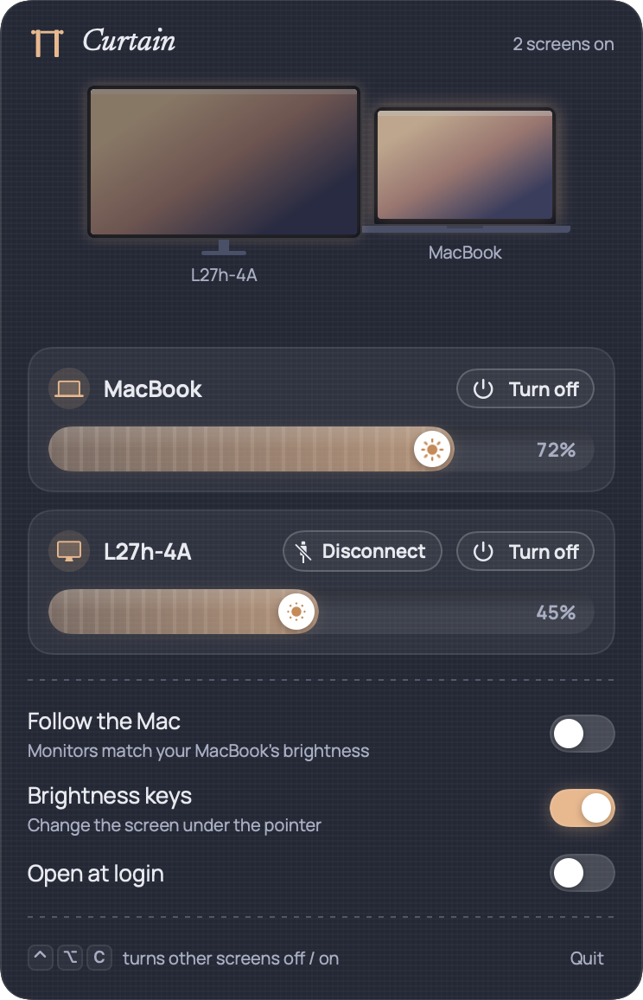
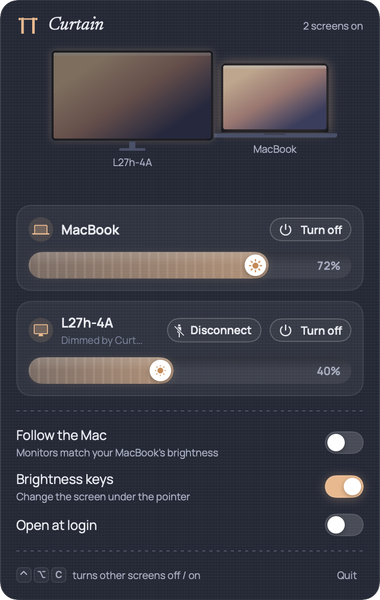

<p align="center"></p>

<h1 align="center">Curtain</h1>

<p align="center">
  <a href="https://github.com/saaquiblabs/curtain/tags"></a>
  <a href="LICENSE"></a>
  
</p>

**How much light each screen lets in.** Curtain sits in your menu bar and gives every screen a
brightness slider, plus a curtain to switch any of them off. Free, open source, sends nothing
anywhere. A Saaquib Labs tool. MIT.

<p align="center">
  
  
</p>

```bash
brew install saaquiblabs/tap/curtain
```

**Needs:** macOS 13 Ventura or newer. Hardware brightness over DDC needs Apple silicon; on Intel
Macs Curtain dims monitors in software instead (turning screens off works on both).

## What it does

1. **Brightness for every screen.** A slider per monitor that sets its real backlight over DDC.
   Monitors that ignore DDC are dimmed in software instead; Curtain notices that by itself and
   says so in the screen's row.
2. **Turn a screen off.** Click **Turn off** and the screen fades to black in half a second, with
   no flash on your other screen. Its windows stay where they are; **Turn on** brings it back.
   Or click **Disconnect** on a monitor: macOS treats it as unplugged, moves its windows to your
   other screen and lets the monitor sleep (every screen blinks black for a moment while macOS
   rearranges them); **Reconnect** brings it back. The MacBook screen has no Disconnect: macOS
   would switch off its keyboard and trackpad. Curtain never lets you switch off your last screen,
   and keeps a disconnected screen disconnected after sleep or unlock.
3. **Brightness keys for monitors.** F1/F2 change the screen under the pointer, with the native
   macOS brightness indicator.
4. **Follow the Mac.** Your monitors follow your MacBook's brightness as it changes.
5. **⌃⌥C** (Control+Option+C) turns off every screen except the one you're working on, or turns them all back on.

With two screens or more, the menu opens on a **map of your desk**: each screen drawn where it
really sits, as bright as it really is, with drapes closed over it when it's off and a dashed
outline when it's disconnected. Hover a screen on the map and its row lights up. Hover a
button and the map shows what it will do, halfway, with one line saying it (only on the map,
never on a real screen).

Quitting, logging out or stopping Curtain in any way puts every screen back on, at the
brightness it had.

| On | Dimmed in software | Off |
|:-:|:-:|:-:|
|  |  |  |
|  |  |  |

## Install

**With Homebrew** (recommended). Open Terminal and paste:

```bash
brew install saaquiblabs/tap/curtain
```

(No Homebrew yet? Get it from [brew.sh](https://brew.sh) first.) Homebrew builds Curtain on your
Mac, so it needs Apple's command line tools (`xcode-select --install`, no Xcode), and puts
**Curtain.app** in /Applications, where Spotlight finds it. `brew upgrade` quits Curtain, swaps it
and opens it again.

**From source.** With the command line tools installed:

```bash
git clone https://github.com/saaquiblabs/curtain.git
cd curtain
make app          # builds build/app.noindex/Curtain.app
make run          # builds it and opens it
make install      # copies it to /usr/local (PREFIX=/Applications for Spotlight)
```

## First run

Open **Curtain** from Spotlight or /Applications. It has no Dock icon: look for the curtain in
your menu bar and click it. Switch on **Open at login** in the menu if you want it every day.

**One permission, only for the brightness keys.** F1/F2 need **Accessibility**, so Curtain can
catch the keys before macOS does. The menu shows a link while it's missing: open **System
Settings → Privacy & Security → Accessibility** and switch on **Curtain**. Everything else works
without it. Upgrading keeps the permission: Curtain is signed with your Mac's own "Curtain Local
Signing" certificate, made the first time it's built.

## Quit and uninstall

**Quit** is at the bottom right of the menu. Every screen comes back on.

```bash
brew uninstall curtain
```

quits Curtain first, then removes it. To clear what's left:

```bash
tccutil reset Accessibility com.saaquiblabs.curtain     # the Accessibility entry
defaults delete com.saaquiblabs.curtain                 # its settings
```

Built from source? Delete `build/app.noindex/Curtain.app` (or the copy `make install` made), and the signing
keychain `~/Library/Keychains/curtain-signing.keychain-db` if you don't build it again.

## Build

```bash
make app          # build/app.noindex/Curtain.app, signed with the local certificate
make test         # logic tests (touch no display)
make renders      # pictures of the real menu from made-up screens, in build/renders
make screenshots  # refreshes docs/screenshots and docs/img/social-preview.png from the renders
make icon         # redraws Resources/AppIcon.icns from Tools/app-icon
open build/app.noindex/Curtain.app --args --show   # opens the menu in a floating panel
```

The first `make app` makes a self-signed "Curtain Local Signing" certificate in its own keychain
file (`~/Library/Keychains/curtain-signing.keychain-db`) and signs every build with it, so the
Accessibility permission survives rebuilds. `Tools/check-signing.sh` checks that it does.

## How the curtain works

**Turn off** fades the screen's colours to black, covers it with a black window that blocks
clicks, and turns its backlight down where it can. Nothing is rearranged, so nothing flashes.

**Disconnect** calls `CGSConfigureDisplayEnabled`, an undocumented macOS function that tells macOS to
treat a display as unplugged. Apps like BetterDisplay and Lunar sell the same feature as part of a
paid plan. Because the function is undocumented, Curtain looks it up when it starts: if a future
macOS removes it, Disconnect stops working and the rest of the app keeps going.

## Credits

The DDC code (`Sources/DDC.swift`), the brightness indicator (`Sources/OSD.swift`) and the
private function declarations (`Sources/Private.swift`) are ported from
[MonitorControl](https://github.com/MonitorControl/MonitorControl) (MIT). Their licence is in
[NOTICE](NOTICE). Thank you to its authors.

## Licence

The code is MIT © Najmush Saaquib, see [LICENSE](LICENSE). The Curtain name and icon are
Saaquib Labs' and aren't covered by the MIT licence: please don't use them for a fork or another
product.
